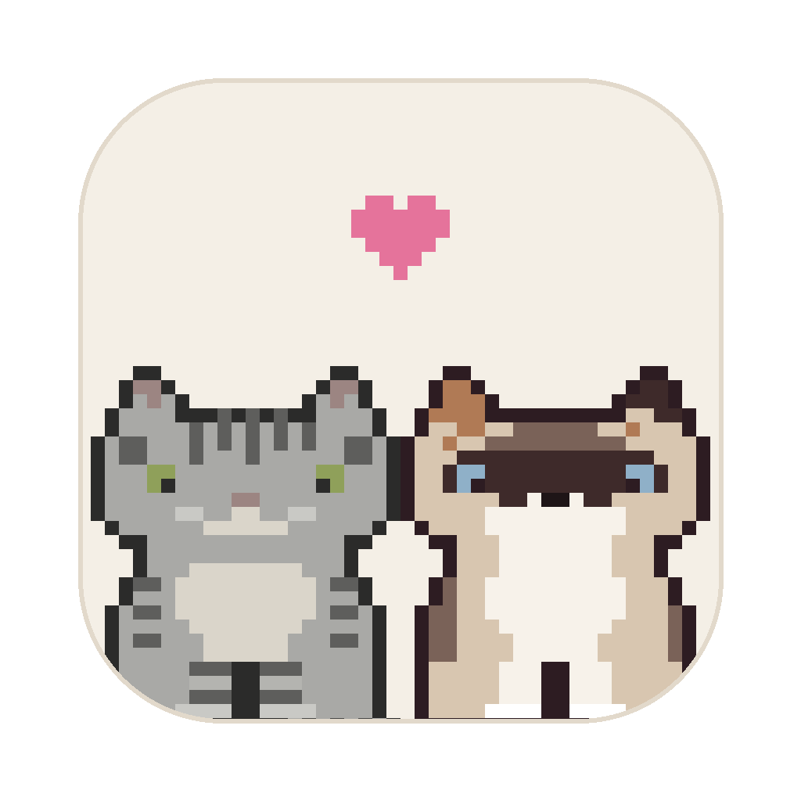
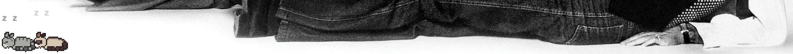
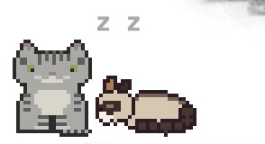

  

<h1 align="center">Desktop Cats</h1>

  Meine beiden Katzen Malia und Molly als Pixel-Art-Haustiere auf dem Mac-Desktop.

  
  

## Die beiden

**Malia** ist gemütlich. Sie läuft langsam, schläft viel und mag Nähe nur, wenn sie selbst
gerade Lust darauf hat. Ihr Kuschelbedürfnis steigt mit der Zeit: Ist es niedrig, steht sie
auf und geht weg, wenn Molly zu nah kommt. Ist es hoch, legt sie sich selbst zu ihr.

**Molly** ist verspielt. Sie ist schneller, sucht oft Malias Nähe, jagt den Mauszeiger und
sammelt Energie, bis sie ein paar Sekunden wild über den Bildschirm tobt.

## Funktionen

- Animierte Pixel-Art zum Laufen, Sitzen und Schlafen
- Eigenes Verhalten für jede Katze über Zustände und innere Werte (Kuschelbedürfnis, Energie)
- Streicheln mit der Maus, Malia reagiert nur bei guter Laune
- Mausjagd am unteren Bildschirmrand
- Stimmungsanzeige im Menü der Menüleiste
- Nachts schlafen beide deutlich mehr
- Ein- und Ausblenden mit `Cmd + Shift + K`

## Technik

- **Electron** mit einem durchsichtigen, klickdurchlässigen Fenster über dem Desktop
- **JavaScript** mit Klassen und Vererbung: Basisklasse `Cat`, davon abgeleitet `Malia` und `Molly`
- Kommunikation zwischen Haupt- und Renderprozess über eine `preload`-Brücke (IPC)
- Selbst erstellte Pixel-Art (32 × 28 Pixel)

## Installation

Die fertige App für Macs mit Apple-Chip gibt es unter [Releases](../../releases).
Da die App nicht bei Apple signiert ist, warnt macOS beim ersten Öffnen. Sie lässt sich
dann über Systemeinstellungen → Datenschutz & Sicherheit → „Trotzdem öffnen“ starten.

## Selbst starten und bauen

Voraussetzung: [Node.js](https://nodejs.org) ist installiert.

    npm install
    npm start

Eigene App bauen:

    npm run package

## Entstehung

Freizeitprojekt, entwickelt mit KI-Unterstützung. Konzept, Persönlichkeiten und Verhalten
der Katzen basieren auf meinen eigenen Katzen.